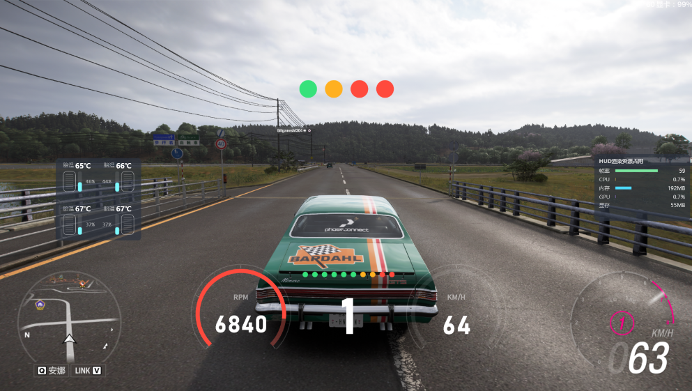
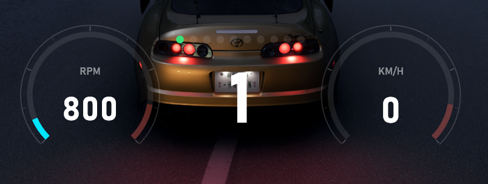
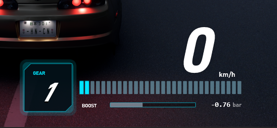

# Forza Fat Fish HUD

> 中文名：**Forza大肥鱼HUD**
> 适用于《极限竞速：地平线》（Forza Horizon）系列的开源免费实时遥测 HUD 悬浮层。

**关键词**：极限竞速 地平线 HUD、Forza Horizon HUD、赛车遥测、悬浮仪表、转速表、档位显示、轮胎温度、悬挂行程、GPU 覆盖层

Forza Fat Fish HUD 是一个 Windows 桌面 HUD 悬浮层：读取游戏通过 UDP 发送的遥测数据，在游戏画面上方绘制转速、档位、时速、踏板、轮胎温度、悬挂行程等实时仪表。

本软件**完全开源、免费**：无付费功能、无广告、无账号、无数据上传，所有遥测数据只在本机处理。

| 经典仪表 | SHIFT TREE | GHOST LADDER |
|---|---|---|
|  |  |  |

## 功能

- **实时遥测 HUD**：转速、车速、档位、马力、扭矩、增压、四踏板（离合/油门/刹车/手刹）
- **多种仪表样式**：
  - SHIFT TREE：双炮筒 + 换挡灯 + 档位
  - 经典仪表：横排仪表 + 转速条 + 四踏板
  - GHOST LADDER：几何描边仪表 + 分段转速条 + 增压条
- **轮胎与悬挂**：四轮温度、抓地状态变色、悬挂行程条
- **HUD 渲染资源占用**：帧率 / CPU / 内存 / GPU / 显存
- **布局自定义**：拖拽调整各面板位置与大小
- **刷新率**：60 FPS / 30 FPS / 以游戏发包为准
- **全局快捷键**：一键显示/隐藏 HUD
- **智能显示**：仅在驾驶、游戏处于前台时显示

## 系统要求

- Windows 10 1709+ / Windows 11（64 位）
- 支持 Direct3D 11 与 DirectComposition 的显卡
- 游戏内开启遥测输出：`设置 → HUD 与游戏 → 数据输出`，端口 `23333`

## 下载与安装

从 [Releases](https://github.com/FatFishNet/forza-fatfish-hud/releases) 下载最新压缩包，解压后运行 `ForzaFatFishHUD.exe`。免安装、不需要额外安装 .NET 运行时（自包含发布）。

## 使用

1. 启动 `ForzaFatFishHUD.exe`
2. 启动游戏，进入设置开启遥测输出（端口 23333）
3. 进入驾驶，HUD 自动显示；按 `F3` 手动显示/隐藏
4. 在设置窗口调整仪表样式、刷新率、面板开关与布局

## 常见问题

- **HUD 不显示**：确认游戏已识别、处于前台且正在驾驶；检查端口是否被占用
- **快捷键无效**：以管理员身份运行（游戏以管理员启动时热键需要更高权限）
- **画面异常**：查看程序目录下的 `logs/` 日志，或在 Issues 反馈

## 开源协议

本项目使用 [MIT License](LICENSE)。

## 致谢

- 角色形象与图标：© ZipZipPipe，经作者授权二次创作用于本项目
- 第三方组件：见 [THIRD-PARTY-NOTICES.txt](THIRD-PARTY-NOTICES.txt)
- 内置字体 D-DIN：SIL Open Font License 1.1（见 `Assets/Fonts/LICENSE.txt`）

---

# English Summary

Forza Fat Fish HUD is a free and open-source telemetry HUD overlay for Forza Horizon. It reads the game's UDP telemetry and renders RPM, gear, speed, pedals, tire temperatures and suspension travel as an always-on-top transparent overlay using Direct3D 11 + Direct2D + DirectComposition.

No accounts, no ads, no paid features, no telemetry upload — everything runs locally.

Licensed under the MIT License.
